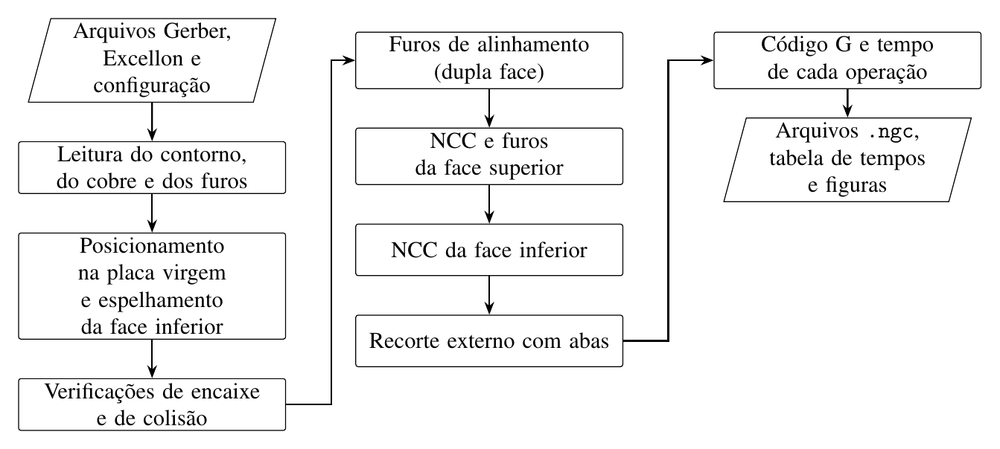
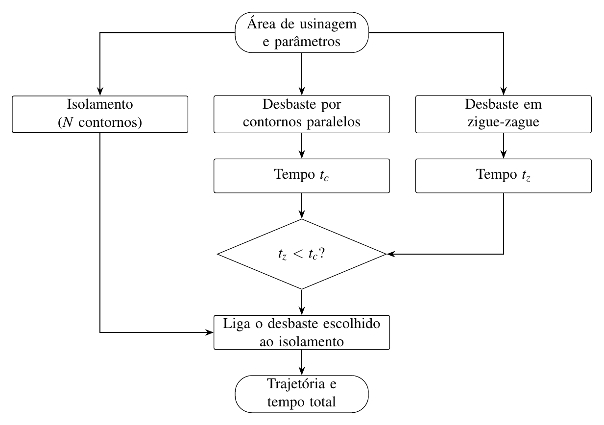
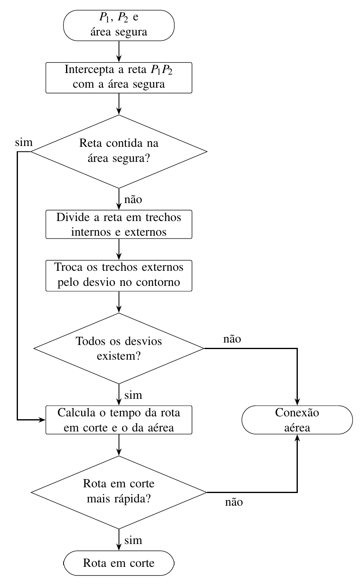
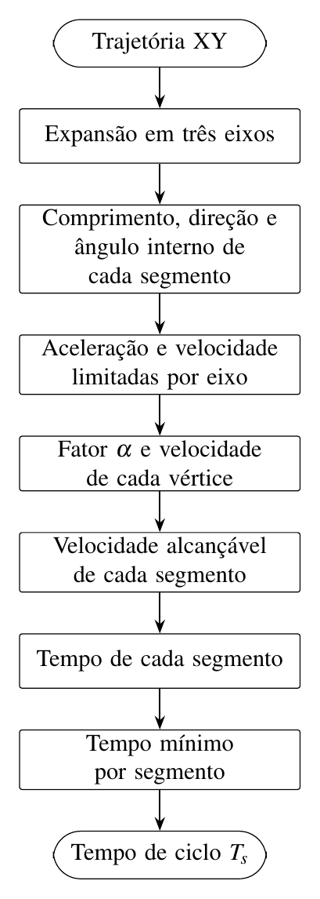
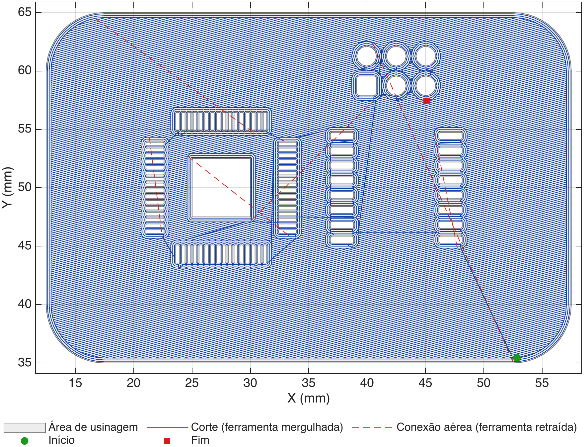
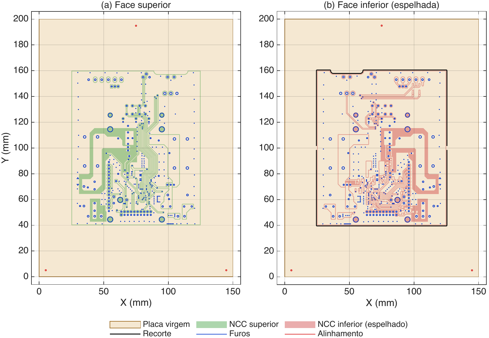

# pcb-cam

Programa de manufatura auxiliada por computador (CAM), em MATLAB, que planeja as trajetórias de fresamento de placas de circuito impresso (PCIs) para a prototipadora PCB-Proto 1 G1 e usa o tempo de execução na CNC como critério das suas decisões.

É o código da monografia *CAM para fresagem de placas de circuito impresso: planejamento de trajetórias orientado pelo tempo de execução na CNC* (Engenharia Eletrônica, IFRS Campus Canoas, 2026).

## Requisitos

- MATLAB R2025a
- RF PCB Toolbox, para ler os arquivos Gerber
- Mapping Toolbox

## Início rápido

No MATLAB, abra a pasta do repositório e execute:

```matlab
exemplo
```

O script planeja a PCB I a partir dos arquivos Gerber e Excellon de `placas/pcb_i`, mostra o tempo estimado de cada operação e grava o código G em `saida/pcb_i/`. Para outra placa, troque os arquivos e as dimensões da placa virgem no início de `exemplo.m`.

## Estrutura

| Caminho | Conteúdo |
|---|---|
| `exemplo.m` | Ponto de início: gera o código G de uma placa |
| `configurar.m` | Adiciona as pastas ao caminho do MATLAB |
| `src/production/` | Fluxo de produção (`pcb_cam`): leitura, posicionamento, dupla face, furos, recorte e código G |
| `src/plan_tool_path.m` | Remoção de cobre de uma face: escolhe o desbaste mais rápido e o liga ao isolamento |
| `src/contour/` | Contornos paralelos sucessivos: rede de contornos (TPE Net), subcaminhos e trajetórias de limpeza |
| `src/lines/` | Retas paralelas em zigue-zague |
| `src/connection/` | Ligação entre trechos de corte, escolhida pelo tempo |
| `src/timing/` | Modelo de tempo de execução com filtros FIR (Ward et al., 2023) |
| `src/io/` | Leitura dos arquivos Gerber e escrita de código G |
| `placas/` | Arquivos das três placas da monografia e a configuração de cada uma (`configurar_placa`) |
| `ensaios/` | Ensaios na máquina, calibração do modelo e resultados da monografia |
| `figuras/` | Figuras deste README, tiradas da monografia |

## Fluxogramas

### Fluxo de produção

Implementado em `src/production/pcb_cam.m`.

<p align="center"></p>

### Remoção de cobre de uma face

Implementada em `src/plan_tool_path.m`. As duas alternativas de desbaste são planejadas, e a de menor tempo estimado é ligada ao isolamento.

<p align="center"></p>

### Ligação entre dois pontos

Implementada em `src/connection/connect_points.m`. A rota em corte só é usada quando é mais rápida que retrair a ferramenta e ir pelo ar.

<p align="center"></p>

### Tempo de execução

Implementado em `src/timing/tempo_modelo_maquina.m`, a partir do modelo de convolução de filtros FIR de Ward et al. (2023).

<p align="center"></p>

## Resultados da monografia

Os scripts de `ensaios/` reproduzem os números dos Capítulos 7 e 8. No MATLAB, execute `configurar` uma vez na raiz do repositório e depois cada script pelo nome.

| Script | O que calcula | Monografia |
|---|---|---|
| `gerar_ensaios` | Códigos G dos ensaios T0, T1 e T3 | Seção 7.1 |
| `calibrar_modelo` | Erro TCP do modelo e erro RMS de cada ensaio | Seções 7.2 e 7.3 |
| `validar_placas` | Tempo medido das placas contra o modelo e contra a estimativa por comprimento e avanço | Tabela 6 (Seção 8.1) |
| `verificar_trajetorias` | Segmentos de corte fora da área permitida à ferramenta | Seção 8.2 |
| `comparar_isolamento` | Isolamento no pior caso, na configuração adotada e no melhor caso | Seção 8.6 |
| `efeito_tempo_minimo` | Acréscimo de tempo causado pelo limite de 16 ms por segmento | Seção 8.7 |

Os dados medidos estão em `ensaios/dados/`: os códigos G e os tempos dos ensaios (`ensaios_maquina/tempos_medidos.csv`) e os códigos G executados na PCB I (`pcb_i/`) e na PCB II (`pcb_ii/`). A remoção de cobre da PCB III foi cronometrada com 4 passes de isolamento e 20% de sobreposição, e `validar_placas` planeja essa placa de novo com essa configuração.

## Placas

| Placa | Pasta | Descrição |
|---|---|---|
| PCB I | `placas/pcb_i` | Face simples, 10 furos. É a única em que o desbaste em zigue-zague é escolhido. |
| PCB II | `placas/pcb_ii` | Dupla face, 39 furos e grandes áreas de cobre. |
| PCB III | `placas/pcb_iii` | Dupla face, 385 furos e trilhas densas. |

<p align="center"></p>

<p align="center"><em>Trajetória de remoção de cobre da PCB I, com desbaste em zigue-zague e isolamento por contornos.</em></p>

<p align="center"></p>

<p align="center"><em>PCB III na placa virgem: face superior, com furos e furos de alinhamento (a), e face inferior espelhada, com o recorte (b).</em></p>

## Licença

O código está sob a licença MIT (arquivo `LICENSE`). Os arquivos das placas pertencem aos seus autores, indicados abaixo.

## Fontes das placas

- **PCB I:** arquivo de teste da TTP Indústria Mecânica Ltda., fabricante da PCB-Proto. Disponível em: <https://www.ttp.ind.br>.
- **PCB II:** projeto cedido por Fernando Darski, originado de um trabalho da disciplina de Eletrônica de Potência da Universidade Federal do Rio Grande do Sul (UFRGS).
- **PCB III:** *Hydro Battery Charger*, exemplo do formato Gerber gerado no LibrePCB e distribuído pela Ucamco como "LibrePCB sample 2". Disponível em: <https://www.ucamco.com/en/gerber/downloads>.
